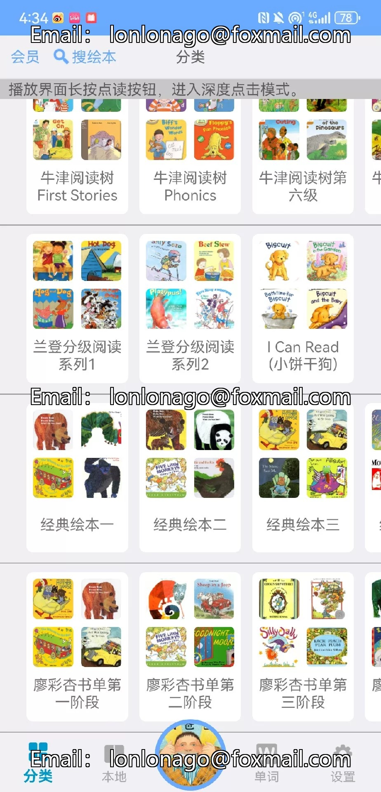

# Voice English Picture Book APP permanent member, Android/HarmonyOS system-specific

## Body

Voice English Picture Book APP permanent member, Android/HarmonyOS system-specific

✅ Contains popular English picture books: Oxford Reading Tree, Pearson, Heinemann, Red Rocket, Liao Cai Xing, and other classic graded reading materials.
✅ Fully functional: Capable of dubbing, translation, point-reading, and changing pronunciation versions.
✅ Rich content: High-definition audiobooks with simultaneous sound and picture, no need to manually flip pages.

[Red circle] [Red circle] [Important reminder
⚠️ Only for Android/HarmonyOS systems installation and use.
⚠️, sold out
⚠️ For any after-sales issues, please contact us at any time.

Shipping Instructions
After placing an order, please be aware of the order.
Friends who like it are welcome to consult.

## Images

## Payment

Here is a pay link on Stripe ( https://buy.stripe.com/3cs8yP7sY87d0vu9AB ). Please contact me lonlonago@foxmail.com after funding $89, and I will send you a complete data files , thank you!

